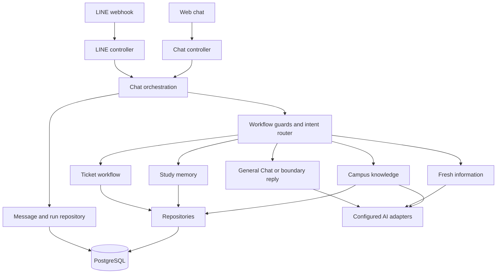

# BU StudyMate Architecture

Source inspected: 2026-10-12, working tree based on `b3adabb`.
Status: source map of an existing application, including uncommitted changes.
Playground local verification is recorded in [playground-01](.scratch/playground/issues/01-admin-playground.md).
Real database/provider UAT and deployment remain unverified by this work.

## Using This Document

Read for onboarding, source ownership, call paths or technical changes. Confirm
the affected source before editing: this snapshot includes work not yet committed.
[AGENTS.md](AGENTS.md) owns working rules, [DESIGN.md](DESIGN.md) owns presentation,
[CONTEXT.md](CONTEXT.md) owns terminology and [.scratch/README.md](.scratch/README.md)
owns work status. Specs/tickets describe intended changes and verification.
Record actual trade-offs under `architecture-decisions/` using
[domain guidance](docs/agents/domain.md); create ADRs only when needed.

## 1. Structure and Ownership

StudyMate is one Next.js App Router application with React, strict TypeScript,
PostgreSQL/Prisma, LINE integration and configured AI providers. Use
[package.json](package.json) and the lockfile for current versions and commands.

| Area | Owner / source entry | Responsibility |
|---|---|---|
| Admin Web Chat | [chat workspace](app/admin/chat/playground.tsx), [upload](app/admin/chat/study-upload.tsx) | Saved sessions, composer, traces/reports and lesson upload. |
| Admin Overview | [overview service](src/services/admin-overview.service.ts), [repository](src/repositories/admin-overview.repository.ts) | Seven Bangkok calendar days of actual identity/run aggregates and current ticket/knowledge counts. |
| HTTP entry points | [chat route](app/api/chat/route.ts), [LINE route](app/api/line/webhook/route.ts) | Delegate to controllers. |
| Request boundaries | [chat controller](src/controllers/chat.controller.ts), [LINE controller](src/controllers/line-webhook.controller.ts) | Parse/validate input, consume limits, handle channel delivery; LINE signature check. |
| Chat orchestration | [ChatOrchestrationService](src/services/chat-orchestration.service.ts) | Workflow guards, route selection, execution and stored run/message linkage. |
| AI routing and answers | [agent router](lib/agent-router.ts), [AI adapter](lib/ai.ts), [fresh information](lib/fresh-info.ts) | Configured model calls and answer generation/retrieval. |
| Campus knowledge | [knowledge service](src/services/knowledge.service.ts) | Rank repository items and rewrite an answer from selected content; report misses. |
| Study memory | [study service](src/services/study-memory.service.ts), [file ingestion](lib/study-file.ts) | Saved notes/materials, assignments, tutoring, file extraction/OCR. |
| Facility tickets | [ticket service](src/services/ticket.service.ts) | Draft/session workflow, confirmation, creation and status lookup. |
| Presentation | [web presenter](src/presenters/chat-response.presenter.ts), [LINE presenter](src/presenters/line-flex.presenter.ts) | Channel response shaping; LINE presenter wraps [Flex templates](lib/flex-messages.ts). |
| Persistence | `src/repositories/`, [schema](prisma/schema.prisma), [Prisma client](lib/prisma.ts) | Prisma-backed reads/writes and persisted contracts. |
| Configuration | [validated environment](src/config/env.ts) | Central application configuration; secret values stay outside documentation. |
| Admin Playground | [controller](src/controllers/playground.controller.ts), [service](src/services/playground.service.ts), [guide](docs/playground.md) | Saved web test sessions, run traces and printable reports; present in the working tree. |
| Evaluation | [eval guide](evals/README.md), [concise-chat checks](lib/concise-chat.test.ts) | Synthetic regression checks and separately configured provider evaluations. |

The layered convention is route → controller → service → repository, with
presenters for channel output and `lib/` for adapters/facades. It is a maintenance
rule, not proof that every legacy file follows it: orchestration/controllers still
contain some text formatting, and older admin pages use their own auth checks.
Keep future changes scoped to the appropriate owner rather than restructuring
unrelated code while following this map.

## 2. Chat Request Path

`ChatController.handleWebChat` validates JSON through the DTO, normalizes the
browser session identity, applies rate limits and calls `createBotReply` with
channel `web`. The LINE controller verifies the request signature, extracts the
LINE identity, applies limits and sends text or the returned Flex payload.

`createBotReply` loads session/history, resolves workflow guards and the route,
then creates user-message/run records before executing the chosen branch. It
stores the assistant reply and completion metadata, or marks an existing run as
failed. Errors before run creation may have no saved run. Router labels/flags
are stored observations; they are not independent proof of external calls.

Web sends receive complete JSON replies; do not infer token streaming from the
typing indicator. File uploads use a separate controller path and
`saveStudyFile`; they are not ordinary text-chat turns.

## 3. Data and Identity Boundaries

[prisma/schema.prisma](prisma/schema.prisma) owns the persisted shape:

- `KnowledgeItem`: campus content, keywords and source. An embedding field exists;
  the inspected knowledge service uses lexical ranking, not vector retrieval.
- `ChatSession` and `Ticket`: workflow state/drafts and facility records.
- `ChatMessage` and `BotRun`: conversation records and linked execution metadata.
- `Notebook`, `UserMemory`, `StudyMaterial`, `MaterialChunk`, `Assignment`: saved learning context.
- `RateLimitEvent`: request-limit persistence.

Web session identifiers are normalized by [lib/web-session.ts](lib/web-session.ts).
They identify conversation context, not an authenticated BU student account.
LINE identity comes from the verified webhook event. Keep queries scoped to the
identity expected by each repository. Database migrations/seeding and provider
calls require their own environment and verification; source inspection does
not prove that a deployed database matches the schema.

## 4. Presentation, Admin and Integrations

The same orchestrator serves authenticated admin Web Chat and LINE; delivery differs. Web
shows saved reply text, source links and per-turn metadata.
LINE uses templates/Flex messages through its controller/presenter. See
[DESIGN.md](DESIGN.md) for the UI baseline and intended interaction quality.

The admin workspace uses one signed cookie and web conversation identities;
see [auth service](src/services/admin-auth.service.ts), [admin guide](docs/admin-workspace.md) and
[Playground guide](docs/playground.md). It uses configured database/provider
connections and can make real operational writes. A separate conversation
identity does not make it a dry run.

Playground's message controller calls the shared orchestrator with `channel=web`;
the returned `runId` identifies the persisted turn. Read paths use
`PlaygroundService` → `PlaygroundRepository` → the typed Playground presenter,
scoped to validated `playground-<UUID>` sessions. The client restores its selected
session from tab storage and reloads saved messages/runs. The report page reads
those records afresh without invoking orchestration. No schema change or SSE
contract was introduced. Completed-turn inspection, auth and report refresh were
verified with in-memory persistence through real Next routes/rendering; see the
ticket for checks and their boundaries.

`/login` authenticates via the shared auth controller; `/admin/layout.tsx` renders
the common sidebar/header. Data-reading pages additionally call `requireAdmin`
before queries, since layout rendering does not serialize child data access.
Ticket mutations, Playground APIs and legacy web chat/upload APIs check the same
cookie and same-origin writes. Missing configuration closes access. Password query
strings and the legacy header no longer authorize any admin surface. Root/old web
chat/Playground URLs redirect to the unified workspace. LINE signature checks remain
separate. See [admin-01](.scratch/admin-dashboard/issues/01-unified-workspace.md)
for scope, checks and evidence boundaries.

Overview counts/aggregates run in `AdminOverviewRepository`, including parameterized
SQL for distinct message identities and daily Bangkok buckets. The service fills
the seven-day series and derives run success/intent percentages. Successful run
ratio is not Resolution Rate; stored knowledge counts are not source health.
Read errors show an explicit unavailable state. No schema or paid provider call
is needed for dashboard reads.

## 5. Request / Path / Verify Examples

| Request | Source path | Relevant verification |
|---|---|---|
| Casual chat or ambiguous message | Orchestrator → router/AI → chat-policy presenter | `pnpm test:concise-chat`; inspect fixed boundaries and recorded history behavior. |
| Official BU question | Router → knowledge service; miss may use fresh-info path | Inspect selected evidence and fallback; provider/UAT checks are separate from synthetic tests. |
| Facility issue and confirmation | Orchestrator → ticket service → repositories/presenter | Check draft/confirm/cancel/status sequence in the intended test environment. |
| PDF/DOCX upload | Chat/LINE controller → study-file → study memory | Check parser/OCR errors and identity-scoped persistence with test files. |
| Saved Playground report | Playground controller/service → repository → report UI | Verify auth, transcript linkage and report reads using the guide. |

For code changes run the narrow meaningful checks plus `pnpm typecheck` and
`pnpm lint`. Use `jg` first for unfamiliar behavior and Graphify for relationships,
then confirm current source. Update the graph after code changes as directed by
AGENTS. This documentation task ran source discovery only, not the application
checks above. Record actual results in the relevant ticket before saying verified.

## 6. Maintenance

Update this map when source ownership, request paths, storage, identity,
integration or auth contracts change. Update Design when presentation changes,
and the local index/ticket when work status changes. Proposed modules/endpoints
belong in plans until source and verification evidence support them; no future
implementation roadmap is inferred by this bootstrap.
