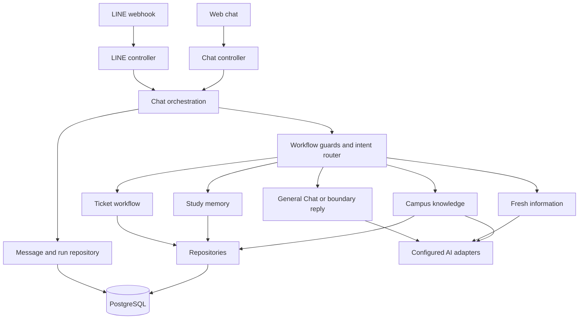

# BU StudyMate Architecture

Source inspected: 2026-10-13, current working tree.
Status: source map of an existing application, including uncommitted changes.
Playground local verification is recorded in [playground-01](.scratch/playground/issues/01-admin-playground.md).
Real database/provider UAT and deployment remain unverified by this work.

## Using This Document

Read for onboarding, source ownership, call paths or technical changes. Confirm
the affected source before editing: this snapshot includes work not yet committed.
[AGENTS.md](AGENTS.md) owns working rules, [DESIGN.md](DESIGN.md) owns presentation,
[CONTEXT.md](CONTEXT.md) owns terminology and [.scratch/README.md](.scratch/README.md)
owns work status. Specs/tickets describe intended changes and verification.
Record actual trade-offs under `architecture-decisions/` using
[domain guidance](docs/agents/domain.md); create ADRs only when needed.

## 1. Structure and Ownership

StudyMate is one Next.js App Router application with React, strict TypeScript,
PostgreSQL/Prisma, LINE integration and configured AI providers. Use
[package.json](package.json) and the lockfile for current versions and commands.

| Area | Owner / source entry | Responsibility |
|---|---|---|
| Admin Web Chat | [chat workspace](app/admin/chat/playground.tsx), [upload](app/admin/chat/study-upload.tsx) | Saved sessions, composer, traces/reports and lesson upload. |
| Admin Overview | [overview service](src/services/admin-overview.service.ts), [repository](src/repositories/admin-overview.repository.ts) | Seven Bangkok calendar days of actual identity/run aggregates and current ticket/knowledge counts. |
| HTTP entry points | [chat route](app/api/chat/route.ts), [LINE route](app/api/line/webhook/route.ts) | Delegate to controllers. |
| Request boundaries | [chat controller](src/controllers/chat.controller.ts), [LINE controller](src/controllers/line-webhook.controller.ts) | Parse/validate input, consume limits, handle channel delivery; LINE signature check. |
| Chat orchestration | [ChatOrchestrationService](src/services/chat-orchestration.service.ts) | Workflow guards, route selection, execution and stored run/message linkage. |
| AI routing and answers | [agent router](lib/agent-router.ts), [AI adapter](lib/ai.ts), [fresh information](lib/fresh-info.ts) | Configured model calls and answer generation/retrieval. |
| Campus knowledge | [knowledge service](src/services/knowledge.service.ts), [query rewrite](lib/knowledge-query.ts), [rerank adapter](lib/knowledge-rerank.ts), [hybrid guide](docs/knowledge-rag.md) | Rewrite follow-ups using recent history, retrieve approved current candidates with keyword/vector RRF, rerank into five passages, generate from cited evidence (appending cited FAQ action links) and report misses. |
| BU Links live lookup | [client](lib/bulinks.ts), [service](src/services/bulinks.service.ts), [presenter](src/presenters/bulinks.presenter.ts), [guide](docs/bulinks-live-lookup.md) | Fresh-info and knowledge-miss questions try live BU Links announcements and service-page links first, with no LLM; a null result or error falls back to web search. |
| Study memory | [study service](src/services/study-memory.service.ts), [file ingestion](lib/study-file.ts) | Saved notes/materials, assignments, tutoring, file extraction/OCR. |
| Knowledge admin | [workspace](app/admin/knowledge/knowledge-workspace.tsx), [controller](src/controllers/knowledge-admin.controller.ts), [service](src/services/knowledge-admin.service.ts) | Authenticated search/pagination, evidence availability, reviewed add/edit and individual source checks through shared ingestion. |
| Admin Users | [page](app/admin/users/page.tsx), [repository](src/repositories/student-account.repository.ts) | Admin table of verified students with run/ticket counts, email search and delete (unbind) behind a type-the-email dialog ([controller](src/controllers/student-admin.controller.ts)). |
| Facility tickets | [ticket service](src/services/ticket.service.ts) | Draft/session workflow, confirmation, creation and status lookup. |
| Presentation | [web presenter](src/presenters/chat-response.presenter.ts), [LINE presenter](src/presenters/line-flex.presenter.ts) | Channel response shaping; LINE presenter wraps [Flex templates](lib/flex-messages.ts). |
| Persistence | `src/repositories/`, [schema](prisma/schema.prisma), [Prisma client](lib/prisma.ts) | Prisma-backed reads/writes and persisted contracts. |
| Configuration | [validated environment](src/config/env.ts) | Central application configuration; secret values stay outside documentation. |
| Admin Playground | [controller](src/controllers/playground.controller.ts), [service](src/services/playground.service.ts), [guide](docs/playground.md) | Saved web test sessions, run traces and printable reports; present in the working tree. |
| Evaluation | [eval guide](evals/README.md), [concise-chat checks](lib/concise-chat.test.ts) | Synthetic regression checks and separately configured provider evaluations. |

The layered convention is route → controller → service → repository, with
presenters for channel output and `lib/` for adapters/facades. It is a maintenance
rule, not proof that every legacy file follows it: orchestration/controllers still
contain some text formatting, and older admin pages use their own auth checks.
Keep future changes scoped to the appropriate owner rather than restructuring
unrelated code while following this map.

## 2. Chat Request Path

`ChatController.handleWebChat` validates JSON through the DTO, normalizes the
browser session identity, applies rate limits and calls `createBotReply` with
channel `web`. The LINE controller verifies the request signature, extracts the
LINE identity, applies limits and sends text or the returned Flex payload.

`createBotReply` loads session/history, resolves workflow guards and the route,
then creates user-message/run records before executing the chosen branch. It
stores the assistant reply and completion metadata, or marks an existing run as
failed. Errors before run creation may have no saved run. Router labels/flags
are stored observations; they are not independent proof of external calls.

Web sends receive complete JSON replies; do not infer token streaming from the
typing indicator. File uploads use a separate controller path and
`saveStudyFile`; they are not ordinary text-chat turns.

## 3. Data and Identity Boundaries

[prisma/schema.prisma](prisma/schema.prisma) owns the persisted shape:

- `KnowledgeItem`: campus content, keywords, canonical source, snapshot hash,
  reviewer and verification/review/validity dates; `sourceKind` PAGE (fetched and
  hash-checked) or FILE (imported file, never fetched) and per-item `actionLinks`.
  Legacy rows are unapproved.
- `KnowledgeChunk`: bounded passages, Thai/English full-text index and compatible
  pgvector embeddings. Repository filters evidence validity before keyword/vector
  ranking; up to 40 fused candidates reach the LLM rerank adapter, which selects
  at most five original passages and falls back to RRF order on failure. Service
  supplies selected passages and validated source IDs to generation. With history,
  the query rewrite adapter resolves follow-ups before embedding/retrieval/rerank,
  falling back to the original query on failure. Generation retains the original
  question/history. Service counts rewrite/rerank usage and reports their
  status/models in the existing execution trace. New knowledge runs also retain
  measured stage durations, query changes, bounded candidate snapshots and
  before/selected ranks in existing run JSON. SQL supplies keyword/vector ranks;
  RRF shares the retrieval SQL duration. Playground validates these optional
  fields on read and Web Chat/report render expandable details. Old logs remain
  readable. No eligible corpus skips these calls.
- `ChatSession` and `Ticket`: workflow state/drafts and facility records.
- `ChatMessage` and `BotRun`: conversation records and linked execution metadata.
- `Notebook`, `UserMemory`, `StudyMaterial`, `MaterialChunk`, `Assignment`: saved learning context.
- `RateLimitEvent`: request-limit persistence.
- `StudentAccount`: one verified `@bumail.net` email bound to one `lineUserId`
  (both unique). Written only by the Google sign-in callback; see
  [student-auth spec](.scratch/student-auth/spec.md).

Student sign-in: the LINE text `ยืนยันนักศึกษา` makes
[the webhook controller](src/controllers/line-webhook.controller.ts) reply with a
`/student/login?link=<signed token>` button (10 minutes, holds the `lineUserId`).
[student-auth.controller](src/controllers/student-auth.controller.ts) starts the Google
OpenID Connect flow and, in the callback, accepts only a Google ID token with
`email_verified`, `hd` and the email domain equal to `STUDENT_EMAIL_DOMAIN`
(default `bumail.net`) before binding and setting the `studymate-student` cookie
(lax, 8 hours). Tokens are HMAC-signed with `STUDENT_AUTH_SECRET`
([signed-token.ts](src/services/signed-token.ts)); Google calls live in
[lib/google-oidc.ts](lib/google-oidc.ts). Google Cloud setup: OAuth client type Web,
redirect URI `<APP_URL>/api/student/auth/google/callback`, env `GOOGLE_CLIENT_ID`,
`GOOGLE_CLIENT_SECRET`, `STUDENT_AUTH_SECRET`. On LINE, text, file and follow events from a `lineUserId` with no `StudentAccount` get a
verify card instead of any bot reply (skipped when student auth is not configured); web `/chat`
is not gated.

Web session identifiers are normalized by [lib/web-session.ts](lib/web-session.ts).
They identify conversation context, not an authenticated BU student account.
LINE identity comes from the verified webhook event. Keep queries scoped to the
identity expected by each repository. Database migrations/seeding and provider
calls require their own environment and verification; source inspection does
not prove that a deployed database matches the schema.

## 4. Presentation, Admin and Integrations

The same orchestrator serves authenticated admin Web Chat and LINE; delivery differs. Web
shows saved reply text, source links and per-turn metadata.
LINE uses templates/Flex messages through its controller/presenter. See
[DESIGN.md](DESIGN.md) for the UI baseline and intended interaction quality.

The admin workspace uses one signed cookie and web conversation identities;
see [auth service](src/services/admin-auth.service.ts), [admin guide](docs/admin-workspace.md) and
[Playground guide](docs/playground.md). It uses configured database/provider
connections and can make real operational writes. A separate conversation
identity does not make it a dry run.

Playground's message controller calls the shared orchestrator with `channel=web`;
the returned `runId` identifies the persisted turn. Read paths use
`PlaygroundService` → `PlaygroundRepository` → the typed Playground presenter,
scoped to validated `playground-<UUID>` sessions. The client restores its selected
session from tab storage and reloads saved messages/runs. The report page reads
those records afresh without invoking orchestration. No schema change or SSE
contract was introduced. Completed-turn inspection, auth and report refresh were
verified with in-memory persistence through real Next routes/rendering; see the
ticket for checks and their boundaries.

`/login` authenticates via the shared auth controller; `/admin/layout.tsx` renders
the common sidebar/header. Data-reading pages additionally call `requireAdmin`
before queries, since layout rendering does not serialize child data access.
Ticket mutations, Playground APIs and legacy web chat/upload APIs check the same
cookie and same-origin writes. Missing configuration closes access. Password query
strings and the legacy header no longer authorize any admin surface. Root/old web
chat/Playground URLs redirect to the unified workspace. LINE signature checks remain
separate. See [admin-01](.scratch/admin-dashboard/issues/01-unified-workspace.md)
for scope, checks and evidence boundaries.

Admin sign-in is per person: `users` (students and admins together) with `roles`/`user_roles`
(`student`, `admin`, `viewer`). `AdminAuthService` verifies a scrypt password, issues a cookie holding only
user id and expiry, and re-reads user and roles on every request; `authorize(request, "read"|"write")`
returns ok/unauthenticated/forbidden (viewer reads, only admin writes). Provisioning is
`pnpm admin:create`/`admin:reset`. `StudentAccountRepository` now reads `users`; `student_accounts` is deprecated.

`/admin/knowledge` requires admin auth before loading its initial list. Its
`/api/admin/knowledge` read/save, `/source` snapshot and `/{id}/check` endpoints
use the same cookie, same-origin writes and strict DTO validation. Repository
search/count reads page through all documents, including unapproved legacy rows.
Availability explains current approval, validity, source and compatible-index
gates; it does not claim factual correctness. Admin saves reuse reviewed ingestion
and atomic document/chunk replacement. The repository verifies the selected
identity inside the transaction: creates reject title collisions and edits keep
the original title/ID. CLI manifests retain their existing upsert-by-title behavior.
Individual checks reuse the scheduled checker with an optional ID filter; they
do not renew review dates. No schema or retrieval-policy change was introduced.

The reference UI adds repository-backed corpus counts and category/status/source
filters before pagination. Counts use the approval, date, source, content
fingerprint and compatible passage gates; no processing history is inferred.
`GET /api/admin/knowledge/{id}` reads ordered indexed passages without vectors.
Detail tabs and article previews use stored text. Per-document usage/file metadata
is unavailable; question testing reuses Web Chat and saved Knowledge Base runs.

`POST /api/admin/knowledge/bulk` accepts 1–50 distinct, explicitly selected UUIDs
and their loaded `updatedAt` versions. Strict DTOs allow deletion or category/
keyword replacement only. Admin service prepares compatible passage embeddings
in batches of at most 32 before mutation; keyword-only updates reuse vectors.
Repository serializable transactions recheck selected versions, update metadata
and lexical/fingerprint/vector fields together, or delete selected articles with
cascading passages. Stale/missing records fail the whole batch. Stale/unindexed
evidence keeps an invalid fingerprint and cannot be promoted by metadata edits.
Text, sources and approval/validity dates are preserved; no schema was added.

Overview counts/aggregates run in `AdminOverviewRepository`, including parameterized
SQL for distinct message identities and daily Bangkok buckets. The service fills
the seven-day series and derives run success/intent percentages. Successful run
ratio is not Resolution Rate; stored knowledge counts are not source health.
Read errors show an explicit unavailable state. No schema or paid provider call
is needed for dashboard reads.

## 5. Request / Path / Verify Examples

| Request | Source path | Relevant verification |
|---|---|---|
| Casual chat or ambiguous message | Orchestrator → router/AI → chat-policy presenter | `pnpm test:concise-chat`; inspect fixed boundaries and recorded history behavior. |
| Official BU question | Router → knowledge service; miss may use fresh-info path (BU Links lookup first, then web search) | Inspect selected evidence and fallback; provider/UAT checks are separate from synthetic tests. |
| Reviewed knowledge import / source check | CLI or authenticated check controller → ingestion service → repository / bounded source adapter | `pnpm test:knowledge`, isolated `pnpm test:knowledge:db`; real corpus approval and deployment remain separate. |
| Facility issue and confirmation | Orchestrator → ticket service → repositories/presenter | Check draft/confirm/cancel/status sequence in the intended test environment. |
| PDF/DOCX upload | Chat/LINE controller → study-file → study memory | Check parser/OCR errors and identity-scoped persistence with test files. |
| Saved Playground report | Playground controller/service → repository → report UI | Verify auth, transcript linkage and report reads using the guide. |

For code changes run the narrow meaningful checks plus `pnpm typecheck` and
`pnpm lint`. Use `jg` first for unfamiliar behavior and Graphify for relationships,
then confirm current source. Update the graph after code changes as directed by
AGENTS. This documentation task ran source discovery only, not the application
checks above. Record actual results in the relevant ticket before saying verified.

## 6. Maintenance

Update this map when source ownership, request paths, storage, identity,
integration or auth contracts change. Update Design when presentation changes,
and the local index/ticket when work status changes. Proposed modules/endpoints
belong in plans until source and verification evidence support them; no future
implementation roadmap is inferred by this bootstrap.
